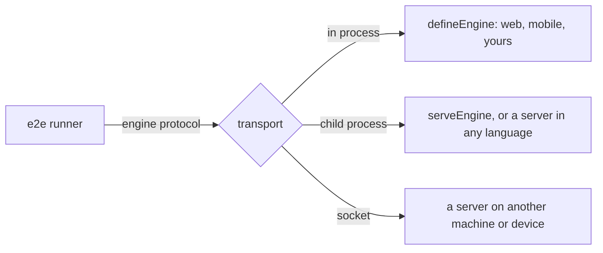

エンジンは、`screen`、`app`、エージェントからの要求に応じて、ブラウザ、シミュレーター、テレビなどのユーザーインターフェースを操作します。ランナーは、すべてのエンジンを[エンジンプロトコル](/reference/engine-protocol)経由で操作します。各エンジンメンバーの呼び出しが、ひとつの JSON-RPC メッセージになります。`@e2e-dev/web` と `@e2e-dev/mobile` もエンジンです。

## 実装方法を選ぶ

| 作りたいもの | 実装方法 | ガイド |
| --- | --- | --- |
| TypeScript のエンジン | `defineEngine` で定義し、ターゲットに設定 | [エンジンを作る](/writing-an-engine) |
| 独立したプロセスで動く TypeScript エンジン | `defineEngine` で定義し、`serveEngine` で提供 | [エンジンサーバー](/engine-servers#serve-a-typescript-engine) |
| 他の言語で作るエンジン、またはデバイス上で動くエンジン | プロトコルのメッセージに応答するサーバー | [エンジンサーバー](/engine-servers#write-a-server-in-another-language) |

`defineEngine` で作ったエンジンは、ランナーのプロセス内で動きます。それでもすべての呼び出しがプロトコルを通るため、テストスイートに合格するエンジンは、別の場所にあるサーバーへ渡せない情報に依存しません。

## 次のステップ

<CardGroup cols={2}>
  <Card title="エンジンを作る" icon="code" href="/writing-an-engine">
    `defineEngine` を使って、順を追ってエンジンを実装します。
  </Card>
  <Card title="エンジンサーバー" icon="network-wired" href="/engine-servers">
    別のプロセス、マシン、言語でエンジンを動かします。
  </Card>
  <Card title="e2e/engine" icon="book" href="/reference/engine">
    エンジン契約のすべての型とフックを確認します。
  </Card>
  <Card title="エンジンプロトコル" icon="book" href="/reference/engine-protocol">
    サーバーが受け取る各メッセージを確認します。
  </Card>
</CardGroup>
