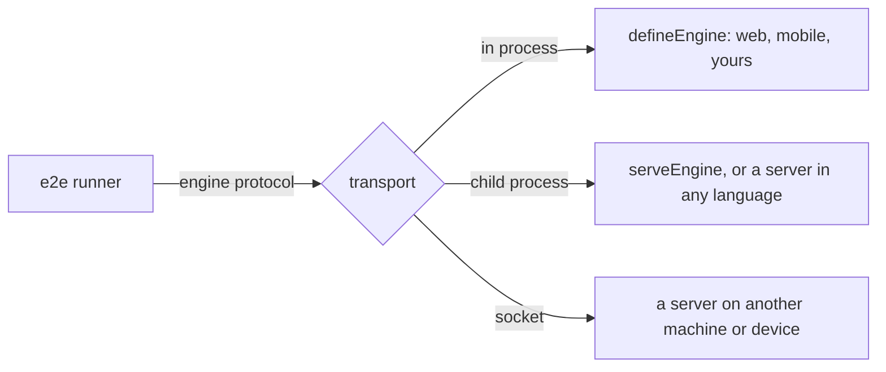

引擎为 `screen`、`app` 和智能体操作用户界面，例如浏览器、模拟器或电视。运行器通过[引擎协议](/reference/engine-protocol)驱动所有引擎，每个引擎成员对应一条 JSON-RPC 消息。`@e2e-dev/web` 和 `@e2e-dev/mobile` 也是引擎。

## 选择编写方式

| 你的需求 | 编写内容 | 指南 |
| --- | --- | --- |
| 使用 TypeScript 编写引擎 | `defineEngine`，配置在测试目标上 | [编写引擎](/writing-an-engine) |
| 在独立进程中运行 TypeScript 引擎 | `defineEngine`，通过 `serveEngine` 提供服务 | [引擎服务器](/engine-servers#serve-a-typescript-engine) |
| 使用其他语言编写引擎，或在设备上运行引擎 | 响应协议消息的服务器 | [引擎服务器](/engine-servers#write-a-server-in-another-language) |

`defineEngine` 创建的引擎在运行器进程中运行。每次调用仍然经过协议，因此，通过测试套件的引擎所需的所有内容，都能由其他位置的服务器接收。

## 下一步

<CardGroup cols={2}>
  <Card title="编写引擎" icon="code" href="/writing-an-engine">
    逐步使用 `defineEngine` 构建引擎。
  </Card>
  <Card title="引擎服务器" icon="network-wired" href="/engine-servers">
    在其他进程、机器中运行引擎，或使用其他语言实现引擎。
  </Card>
  <Card title="e2e/engine" icon="book" href="/reference/engine">
    引擎契约中的所有类型和钩子。
  </Card>
  <Card title="引擎协议" icon="book" href="/reference/engine-protocol">
    服务器接收的所有消息。
  </Card>
</CardGroup>
